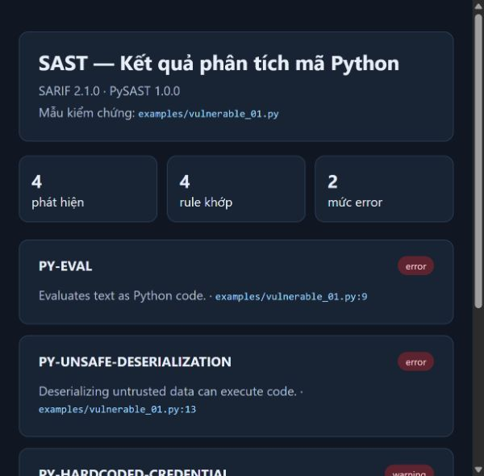
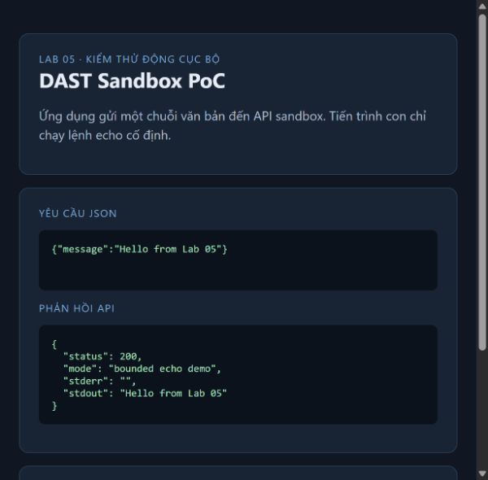

# Buổi 5 — Phân tích và kiểm thử bảo mật

Buổi này gồm hai công cụ thực hành theo Lab 05:

| Bài | Nội dung | Thư mục |
|---|---|---|
| 5.2 | SAST cho mã Python: AST, pattern/rule engine, kiểm tra chất lượng và báo cáo SARIF | [sast-tool](sast-tool/README.md) |
| 5.4 | DAST cục bộ: theo dõi tiến trình, bộ nhớ, thống kê mạng, hành vi và sandbox demo | [dast-tool](dast-tool/README.md) |

Mỗi project có ví dụ, hướng dẫn chạy và unit tests. Ảnh minh chứng nằm trong từng thư mục `minh-chung`.

## Hình ảnh PoC

**SAST:** phân tích `vulnerable_01.py`, báo cáo SARIF 2.1.0 ghi nhận 4 phát hiện.

**DAST:** endpoint sandbox trả thành công chuỗi echo qua tiến trình con giới hạn.

